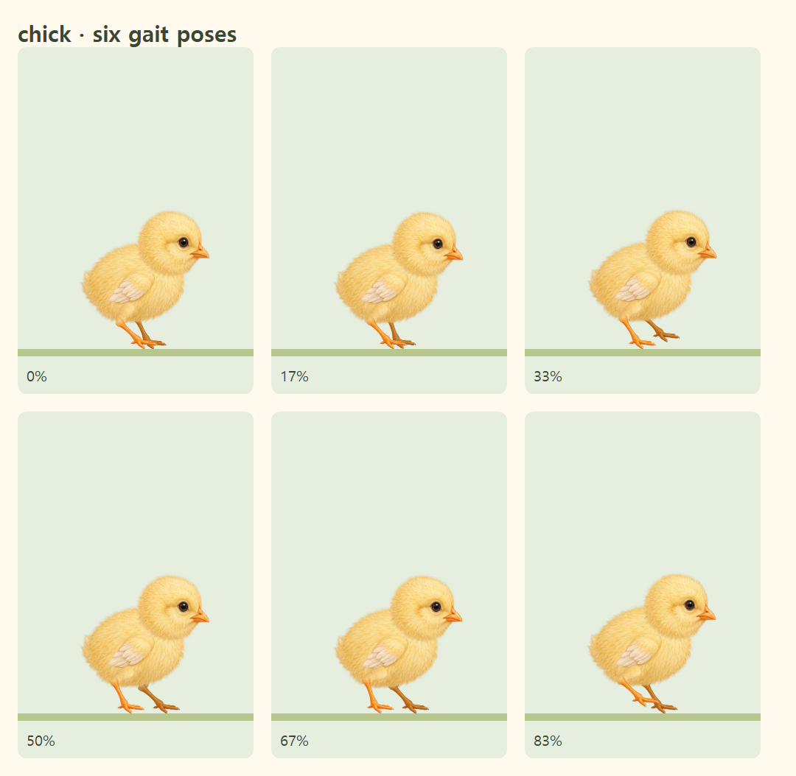

# 병아리 발목 연결 보정

발 원화에는 발가락뿐 아니라 짧은 종아리도 포함되어 있었다. 별도의 종아리 그림과 함께 표시하면서 서로 다른 방향의 종아리가 발목에서 갈라져 보였다. 기존 다리 끝의 좌표도 실제 원화 중심에서 벗어나 있었다.

- 기존 원화와 타이머 구조를 유지하고, SVG 클립으로 발 원화의 중복 종아리 부분을 숨겼다.
- 원화 픽셀 기준으로 다리 끝과 발목의 중심을 다시 지정했다. 두 그림은 같은 발목 관절을 기준으로 연결된다.
- 종아리 그림의 가로 두께를 발목에 맞췄다. 관절 중심과 다리 길이는 변하지 않는다.
- 변경된 발목에서 발바닥까지의 거리로 보행 위치를 계산해 발의 지면 접촉을 유지한다.
- 메인 캐릭터와 진행 경로의 작은 캐릭터에 공통으로 적용한다.

`src/lib/chickAnatomy.ts`에 원화의 연결점·두께·클립 범위를 정의하고, `src/components/PaintedAnimalArtwork.tsx`에서 렌더링한다. `tests/chickAnatomy.test.ts`와 `tests/e2e/chick-artwork.spec.ts`는 원화 중심, 관절 일치, 두 그림의 실제 픽셀 겹침, 중복 종아리 제거와 지면 접촉을 확인한다.

캡처는 `/timer/` 정적 빌드의 실제 SVG이다. 브라우저 검사는 Chromium과 iPhone 화면 설정의 WebKit을 사용하며, 실제 iPhone 기기를 사용한 검사는 아니다.

로컬 검증: TypeScript·ESLint·정적 빌드 및 `/timer/` 경로 검사, 단위 검사 129개, 병아리 보행·진행바 브라우저 검사 4개 통과.
