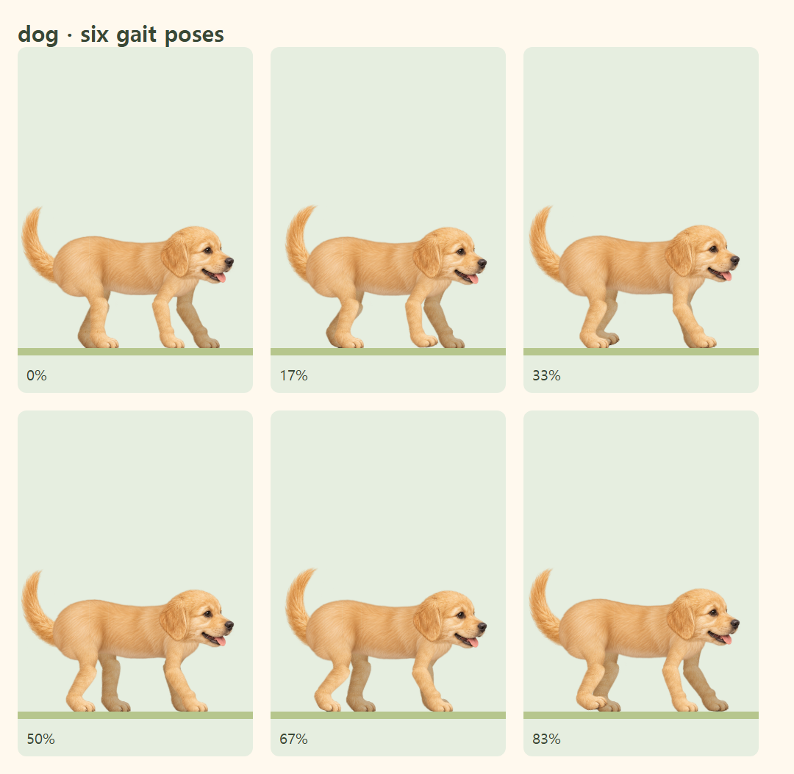
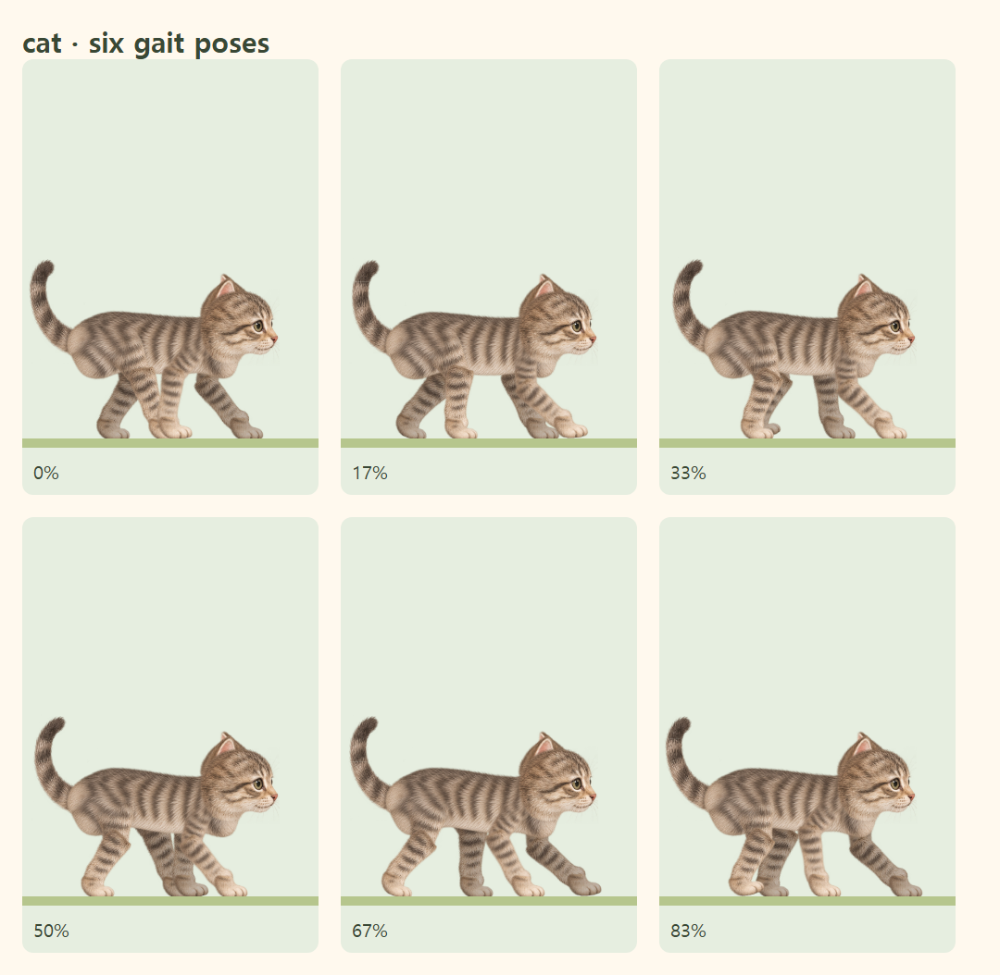

# 고양이·강아지의 서로 다른 보행

v8 원화 자산을 재사용하고 움직임을 분리했습니다. 메인 타이머·진행바·동물 미리보기는 `createAnimalRenderer`로 같은 자세를 그립니다. 새 라이브러리나 이미지 다운로드는 추가하지 않습니다.

## 고양이

- 같은 쪽 뒷발 → 앞발 → 반대쪽 뒷발 → 앞발의 네 박자를 유지합니다.
- 앞발의 이전 착지 위치에 같은 쪽 뒷발이 정확히 착지합니다. 화면 좌표에 지면 이동량을 더한 **월드 좌표**에서 두 발자국이 일치하도록 보폭을 계산합니다.
- 보폭만 늘리면 다리가 과하게 접히므로, 몸통을 원화 비율대로 조금 줄이고 어깨·골반 뿌리를 몸 안쪽으로 올렸습니다. 발은 같은 지면에 닿고, 지지하는 앞다리의 접힘은 65도 이내로 유지됩니다.
- 몸통의 8개 패널이 작은 연속 곡선을 만들고, 어깨와 골반은 반대 리듬으로 움직입니다. 다리 뿌리도 같은 곡면에 붙어 움직이며 IK가 발 접지를 보정합니다.
- 머리는 몸의 작은 상하 움직임을 보상해 높이를 유지합니다. 꼬리는 5개 패널에 위상차를 줘 끝으로 이어지는 부드러운 곡선을 만듭니다.

## 강아지

- 대각선 지지의 시차를 고양이보다 좁혀 더 탄력 있는 리듬을 만듭니다. 네 번의 착지를 구분하고, 공중으로 뛰는 속보로 바꾸지 않습니다.
- 몸통은 고양이보다 단단하게 유지하며, 작은 가슴 반동·머리 끄덕임·귀와 꼬리 리듬을 더합니다.
- 기존의 작은 보폭과 낮은 발 궤적을 유지합니다.

## 실제 보행 자료와 연출 범위

고양이의 같은 쪽 발이 이어지는 걷기는 [고양이 사지 협응 연구](https://pmc.ncbi.nlm.nih.gov/articles/PMC4044364/)를 참고했습니다. 걷는 고양이의 허리 움직임은 작으며 큰 굴곡은 도약·갤럽에서 두드러진다는 [척추 연구](https://pubmed.ncbi.nlm.nih.gov/30184992/)에 따라 과장된 S자 굽힘은 사용하지 않습니다. [견갑대 연구](https://pubmed.ncbi.nlm.nih.gov/642016/)도 작은 어깨 이동의 참고로 사용했습니다.

강아지의 느린 걷기와 속보는 각각 네 박자와 두 박자로 구분되는 [보행 연구](https://pmc.ncbi.nlm.nih.gov/articles/PMC6871776/)를 참고했습니다. 대각선 두 발의 완전한 동시 착지는 속보의 특징이므로, 이 타이머의 편안한 걷기에서는 네 박자의 대각선 지지로 표현합니다. 실제 모션 캡처를 재생하는 모델이 아닌 원화 기반의 2D 일러스트 리그입니다.

## 구현과 검증

- `animalBodyMotion.ts`: 몸통·꼬리 변형, 연결부가 같은 좌표를 공유하는 패널 행렬.
- `animalMotion.ts`, `walkingAnatomy.ts`: 동물별 리듬, 착지·관절·머리 보상.
- `AnimalBodyPanels.tsx`, 두 동물 아트워크: 원화를 비율대로 유지하며 패널을 그리는 SVG 구조.
- `renderAnimalPose.ts`: 노드를 한 번만 찾아 두고 rAF에서 transform만 갱신하는 공통 렌더러.
- `animalActionPose.ts`: 멈출 때 관절과 몸통·꼬리 변형을 함께 감쇠.
- 모션 감소에서는 모든 새 변형도 정지합니다. 일시정지·재개·새로고침은 같은 타임스탬프 기반 자세를 복원합니다.
- 단위 테스트: 실제 발 접지, 양쪽 다이렉트 레지스터, 패널 경계 일치, 꼬리 뿌리 고정, 머리 높이, 몸통 진폭·반복 경계·감쇠.
- 브라우저: 원화 관절·네 발 연결, 실제 렌더링 발자국 일치, 메인/진행바의 변형 동기화, 모바일 일시정지·재개·복원·도착.

