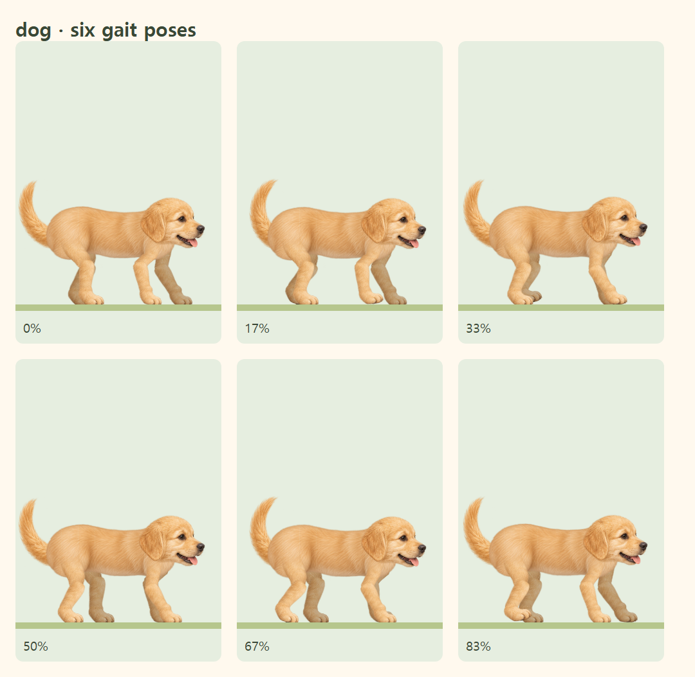
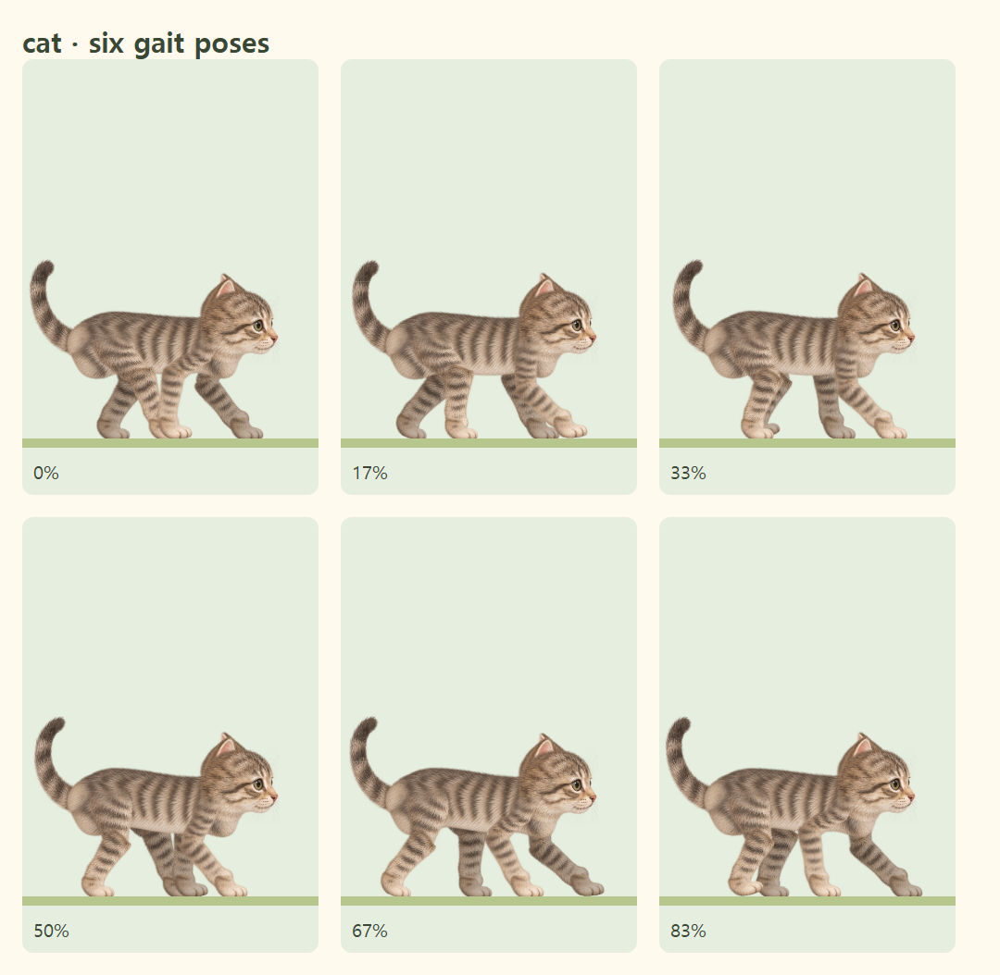

# 강아지·고양이 몸통 접합 보정

기존에는 다리 뿌리의 좌표만 몸통에 맞췄다. 윗다리 그림 전체와 마스크는 관절을 중심으로 회전했기 때문에 허벅지와 어깨가 별도 부품처럼 보였다. 머리도 몸통 표면과 다른 상하 이동을 사용했다.

## 변경

- 기존 원화의 윗다리를 작은 삼각형 패치로 나누었다. 몸통 쪽 피부는 몸통 표면을 따라가고, 무릎 쪽 피부는 기존 관절을 따라간다. 가운데는 부드러운 가중치로 연결한다.
- 패치의 가운데 열을 관절 중심에 두어 피부의 뿌리와 무릎이 실제 관절 위치에 정확하게 붙는다. 공통 꼭짓점을 공유하고 클립을 조금 겹쳐 경계의 가는 틈을 줄인다.
- 접합부 마스크를 회전하는 다리 바깥에 두었다. 몸통 안쪽에서 털이 자연스럽게 이어지고, 몸 밖으로 나오는 부분은 충분히 불투명하게 보인다.
- 머리의 상하 위치는 목이 붙은 몸통 표면에서 계산한다. 기존의 작은 고개 움직임은 유지한다.
- 메인 캐릭터와 진행 경로의 작은 캐릭터가 같은 변형 데이터를 사용한다. 타임스탬프, 보행 순서, 발바닥 접지, 고양이의 앞발 자리를 따라 딛는 동작은 유지한다.
- SVG 노드는 처음에 캐시하고 rAF에서 변환 행렬만 갱신한다. 새 라이브러리나 이미지 파일은 추가하지 않았다.

## 주요 파일

- `src/lib/animalLimbSkin.ts`: 몸통에서 무릎까지 이어지는 피부 변형, 공통 꼭짓점, 클립 경계 보정.
- `src/components/PaintedAnimalArtwork.tsx`: 원화 패치 및 고정된 접합부 마스크.
- `src/lib/animalBodyMotion.ts`, `src/lib/animalMotion.ts`: 목과 몸통의 공통 기준.
- `src/lib/renderAnimalPose.ts`: 메인·진행바·시안 화면의 공통 렌더링.
- `tests/animalLimbSkin.test.ts`, `tests/animalBodyMotion.test.ts`: 접합, 루프 연속성, 패치 뒤집힘 회귀 검사.
- `tests/e2e/walking-animals.spec.ts`, `tests/e2e/progress-characters.spec.ts`: 실제 SVG 좌표 및 렌더링, 접지, 일시정지·새로고침·재개, 도착, 모션 감소 검사.

## 화면 검토

한 보행 주기의 여섯 자세를 실제 정적 빌드에서 캡처했다. 원화 접합과 관절 위치는 12개 시점의 실제 SVG 변환 및 픽셀 연결성 검사도 사용한다. 이 검사는 실제 기기의 움직임 평가를 완전히 대체하지 않는다.

배포 대상은 계속 `https://neegiman.github.io/timer/`이며, `out/` 정적 파일만 사용한다.

## 검증 결과

- TypeScript, ESLint, production build 및 `/timer/` 정적 경로 검사 통과.
- 단위 검사 128개 통과.
- 로컬 브라우저 검사 16개 통과: Chromium 7개, iPhone 화면 설정의 WebKit 9개.
- 실제 SVG의 다리 뿌리 좌우와 목을 몸통 표면과 비교하고, 네 발이 렌더링된 몸통과 연결되는지 확인했다.
- 실제 iPhone 기기의 Safari에서 수행한 검사는 아니다.
