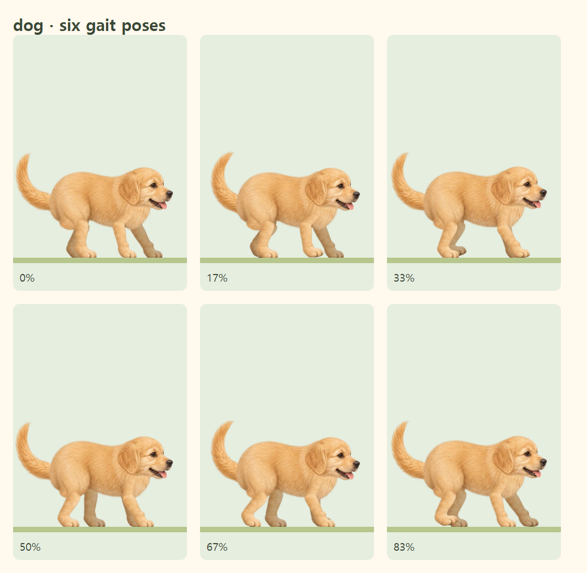
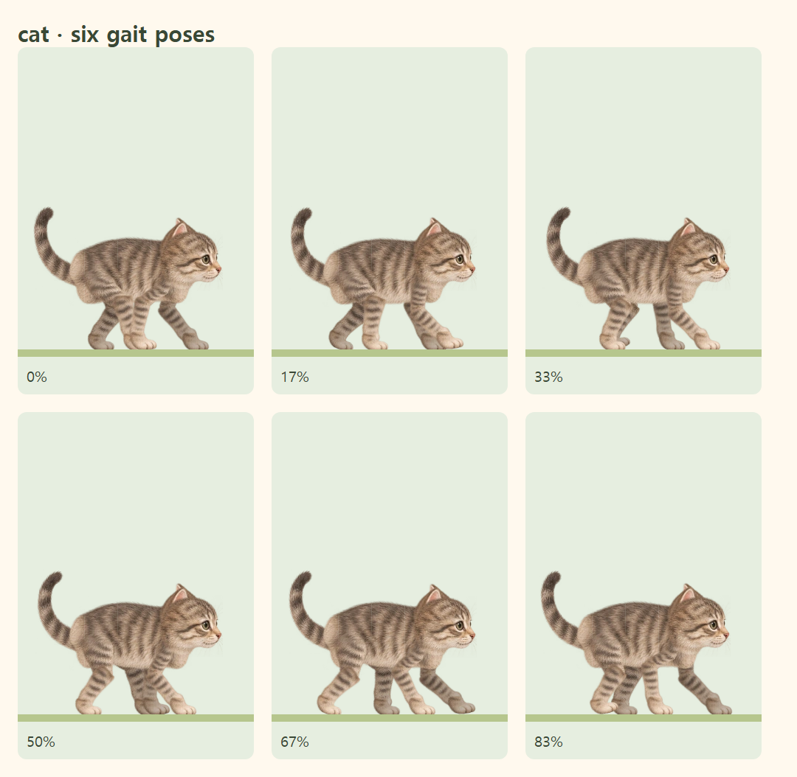

# 선택 원화에 맞춘 강아지·고양이 몸통과 보행 성능

선택 화면의 원화와 함께 제작된 원래 몸통을 그대로 재사용합니다. 따로 그린 긴 v8 몸통 대신 강아지의 둥근 엉덩이·가슴과 고양이의 통통한 허리를 원래 비율로 표시합니다. 짧아진 몸통에 맞춰 엉덩이 관절, 고양이의 다리 길이와 꼬리 연결점을 조정했습니다. 다리 뿌리가 몸통 표면을 따라가는 기존 접합 방식, 발끝 접지와 고양이의 앞발 자리 따라 딛기는 유지합니다.

기존에는 캐릭터 하나에서 상박 64조각, 몸통 8조각, 꼬리 5조각과 나머지 관절을 매 프레임 변형했습니다. 메인과 진행바에 같은 계산과 SVG 페인트가 반복되어 모바일에서 끊김이 발생했습니다.

실제 관절 리그로 만든 한 보행 주기 128프레임을 정적 WebP 시트에 저장하고, 브라우저에서는 경과 시간으로 표시할 프레임만 선택합니다. 메인·진행바는 같은 그림과 보행 시계를 공유합니다. 320×244px 프레임과 2560×3904px 시트는 두 배 해상도를 유지하면서 각 변을 4096px 아래로 제한합니다. 타이머 시간 계산, 배경 속도, 일시정지·재개·복귀 방식은 변경하지 않았습니다.

출발 전·정지·도착 세리머니와 모션 감소는 기존 관절 리그를 사용합니다. 프레임 시트를 읽지 못한 경우에도 리그가 계속 표시됩니다. 동물 시안 페이지도 같은 프레임을 사용하며, `/timer/animal-preview/?rig=1`에서는 원래 관절과 접합부를 직접 검사할 수 있습니다.

원화 또는 관절 코드를 수정한 뒤 `npm run walking-art`로 시트를 다시 생성합니다. Chromium은 생성 도구이며 배포된 사이트에서는 필요하지 않습니다. 입력 파일 지문을 단위 테스트에서 검사하므로 오래된 보행 시트를 그대로 배포하면 검증이 실패합니다.

검증 항목:

- 원화의 원래 비율, 어깨·엉덩이·귀가 실제 불투명한 털 안에 연결되는지 검사
- 모든 128프레임의 실제 그림에서 네 발 접지점이 존재하고 지면 아래가 잘리지 않는지 검사
- 관절 진단의 12자세에서 몸통·머리·다리 접합과 발목까지의 연결 픽셀 검사
- 메인·진행바의 프레임 및 실제 그림 변화, 일시정지·새로고침·재개·모션 감소·도착 후 정지 검사
- 보행 중 숨겨진 몸통·다리 메시가 다시 계산되거나 변형되지 않는지 검사
- 보행 시트 요청 실패 시 캐릭터가 계속 보이고 관절이 움직이는지 검사

성능 측정은 `node scripts/benchmark-walking-animals.mjs artifacts/walkers-performance.json`으로 재현합니다. 먼저 `npm run preview -- --port 17832`로 정적 내보내기를 실행합니다. Chromium 390×844 화면, CPU 4배 감속, 각 캐릭터 6초간 rAF 간격과 작업 시간을 측정합니다. 이 결과는 실제 iPhone 하드웨어의 보장 수치가 아닙니다.

고해상도 최종 성능 측정(같은 환경에서 변경 전후 비교):

| 캐릭터 | 평균 프레임 간격 이전 → 개선 | 95백분위 이전 → 개선 | 6초간 메인 스레드 작업 이전 → 개선 |
|---|---|---|---|
| 강아지 | 26.67ms → 16.71ms | 33.4ms → 16.8ms | 6.02초 → 2.84초 |
| 고양이 | 23.35ms → 16.71ms | 33.4ms → 16.7ms | 6.01초 → 3.10초 |

두 캐릭터 모두 개선 후 측정 구간에서 33.4ms보다 긴 프레임은 0개였습니다.

로컬 최종 검증: TypeScript, ESLint, 정적 프로덕션 빌드·`out/` 경로 검사, 단위 테스트 132개와 관련 브라우저 테스트 26개(Chromium·모바일 WebKit)를 통과했습니다. 일시정지한 여행의 새로고침 비교는 그림 다운로드 완료를 기다린 뒤 검사합니다.

