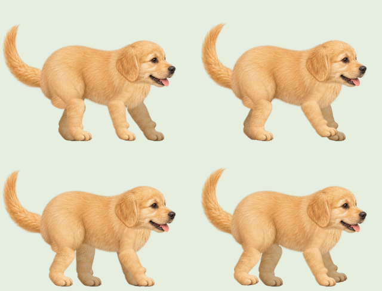
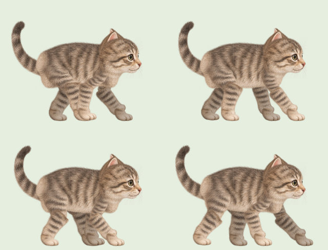

# 털 윤곽을 살린 강아지·고양이 다리

기존 원화의 털과 무늬를 그대로 사용하고 뼈의 수직 방향으로만 다리를 넓혔습니다. 강아지의 윗다리는 18%, 아랫다리는 30%, 고양이의 윗다리는 16%, 아랫다리는 28% 두껍게 표시합니다. 몸통과 이어지는 털, 무릎과 발목의 중심, 발 크기와 접지 높이는 유지합니다.

실제 관절 리그의 128프레임을 다시 생성해 메인 화면과 진행바에 함께 적용합니다. 보행 주기, 배경 속도와 타이머 계산은 그대로입니다. 기존 최적화도 유지해 보행 중에는 복잡한 관절 메시를 매 프레임 다시 변형하지 않습니다.

시안 재현: `npx tsx scripts/bake-walking-animals.tsx --preview`

배포용 생성: `npm run walking-art`

검증: TypeScript, ESLint, 단위 테스트 132개, 정적 빌드와 `/timer/` 자산 경로 검사, Chromium·모바일 WebKit 브라우저 테스트 22개를 통과했습니다. 실제 털 그림의 관절 접합과 발 접지, 진행바 동기화, 일시정지·재개·새로고침·도착, 보행 중 메시 재계산 방지와 그림 로딩 실패 시 대체 표시를 확인했습니다. 공통 다리 렌더러를 사용하는 병아리의 발 접합도 함께 확인했습니다.

