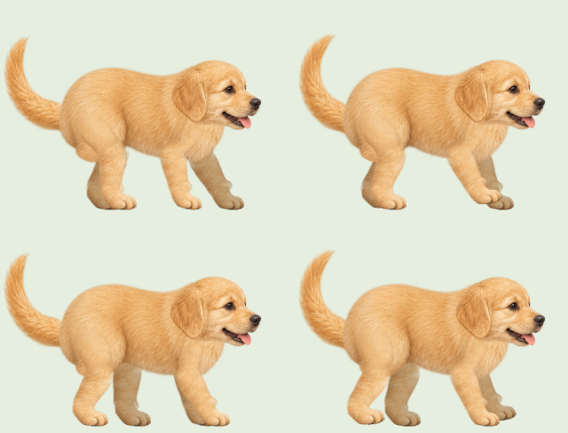
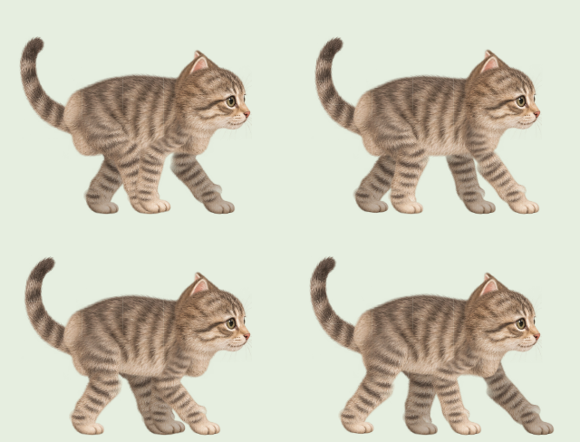

# 다리 관절의 털 연결

강아지와 고양이 다리의 중심은 연결돼 있었지만, 원화 조각 끝의 둥근 윤곽과 진한 테두리가 겹치면서 관절이 분리된 것처럼 보였습니다.

윗다리와 아랫다리 끝을 부드럽게 섞고, 무릎과 발목에 기존 다리 원화에서 가져온 털 연결부를 더했습니다. 연결부는 같은 관절 중심에 고정되며 두 뼈 사이의 각도를 절반씩 따라갑니다. 어깨·엉덩이의 털이 몸통에 섞이는 범위도 넓혔습니다. 발 크기, 뼈 길이, 보행 속도와 접지점은 유지합니다.

보행용 128프레임을 다시 생성해 메인·진행바에 함께 표시합니다. 정지·도착·모션 감소·이미지 로딩 실패 시 사용하는 실시간 관절 리그에도 같은 연결부가 적용됩니다.

재현:

- `npx tsx scripts/bake-walking-animals.tsx --preview`: 네 자세 시안
- `npm run walking-art`: 배포용 128프레임
- `npm test`: 모든 프레임에서 무릎·발목 중심 주변에 불투명한 털이 연속적으로 존재하는지, 발 접지가 유지되는지 검사

검증: TypeScript, ESLint, 단위 테스트 132개, 정적 내보내기 및 `/timer/` 자산 검사, Chromium·모바일 WebKit 브라우저 테스트 22개를 통과했습니다. 관절의 원화 연결, 실제 발 접지, 진행바 동기화, 일시정지·새로고침·재개·모션 감소·도착, 보행 중 메시 재계산 방지와 이미지 로딩 실패 시 대체 표시를 확인했습니다.

