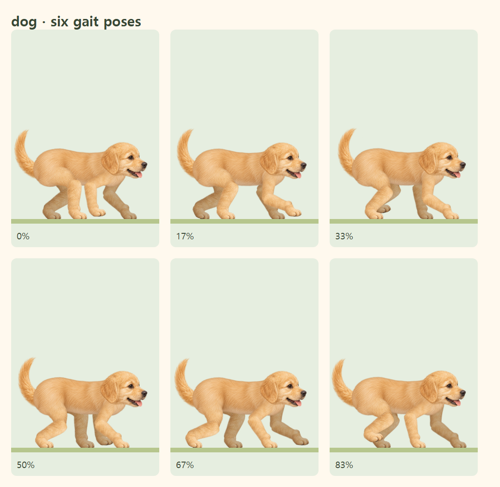
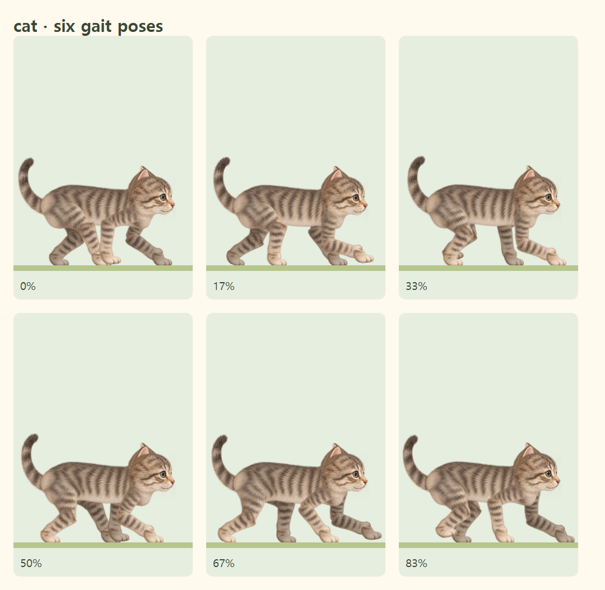

# 강아지·고양이 몸통과 다리 연결 개선

기존 몸통의 깊은 엉덩이·가슴 덩어리가 별도로 움직이는 윗다리와 겹쳐 보였습니다. 내장 **ImageGen**으로 더 얕은 몸통 원화를 만들고, 가까운 다리의 위쪽 경계를 몸통 털 아래로 자연스럽게 연결했습니다. 강아지는 등·갈비뼈·배를 부드럽게 잇고, 고양이는 더 날렵한 몸통과 얕은 허리 곡선을 사용합니다.

## 저장 자산과 최종 프롬프트

| 친구 | ImageGen 원본 | 배포용 자산 |
| --- | --- | --- |
| 강아지 | [dog-torso.png](dog-torso.png) | [dog-torso-v8.webp](../../../public/characters/raster-v1/dog-torso-v8.webp) |
| 고양이 | [cat-torso.png](cat-torso.png) | [cat-torso-v8.webp](../../../public/characters/raster-v1/cat-torso-v8.webp) |

[prompts.json](prompts.json)에 실제 사용한 최종 프롬프트와 참조 파일을 기록했습니다. 도구는 내장 `image_gen.imagegen`, 투명 배경 옵션은 `true`입니다. 기존 전체 아틀라스는 털 색·질감·줄무늬의 참조로 사용했습니다. 첫 시안에는 기존의 큰 덩어리가 남아 있어, 최종 시안은 몸통을 새로 구성하도록 프롬프트를 조정했습니다.

`scripts/prepare-walking-torsos.mjs`는 원화 비율을 유지하고 투명 여백을 제외한 viewBox를 기록하며, 최대 640px 폭의 무손실 WebP를 저장합니다. 코드로 원화 윤곽을 다시 그리거나 픽셀을 지우지 않습니다. `node scripts/prepare-walking-torsos.mjs`로 재생성할 수 있습니다.

## 런타임 연결

`walkingTorsoArt.json`의 새 원화는 `walkingAnatomy.ts`에서 기존 폭에 맞춰 비율을 유지하며 배치합니다. 새 높이는 강아지 약 43, 고양이 약 41 아트 좌표 단위입니다. 네 다리 뿌리와 머리 연결을 확인했으며, 기존 관절·보행 시계·발 접지 계산을 그대로 사용합니다.

`PaintedAnimalArtwork.tsx`의 강아지·고양이 앞쪽에 보이는 윗다리는 엉덩이에서 14, 어깨에서 8 아트 좌표 단위까지 부드럽게 드러납니다. 몸통 위에 짙은 윗다리 경계가 중복되는 것을 줄이면서 다리가 몸에서 나오는 부분을 연결합니다. 먼 다리는 기존처럼 몸통 뒤에 배치합니다. 토끼·병아리의 연결 마스크는 유지합니다. 메인 화면·동물 미리보기·진행바가 같은 렌더러와 `/timer/` 자산 경로를 사용합니다.

## 실제 브라우저의 여섯 보행 자세

## 검증 범위

몸통의 종횡비·얕은 허리·다리 뿌리의 불투명 영역, 실제 렌더링 12개 자세의 네 발 연결과 관절 정합, 발 접지·일시정지·재개·새로고침, 진행바 동기화·도착·모션 감소를 검사합니다. Chrome과 모바일 WebKit으로 검증하며 실제 iPhone 하드웨어 검증을 대체하지는 않습니다.
