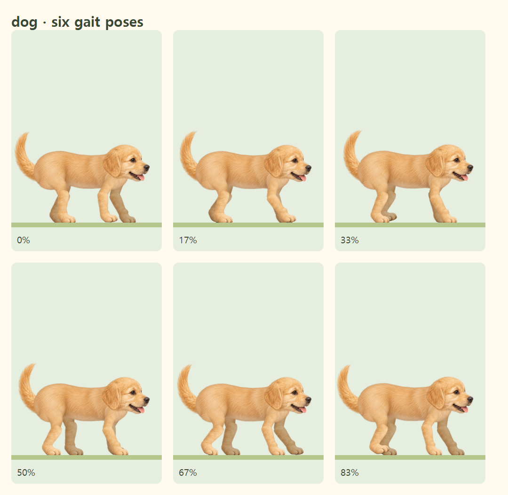
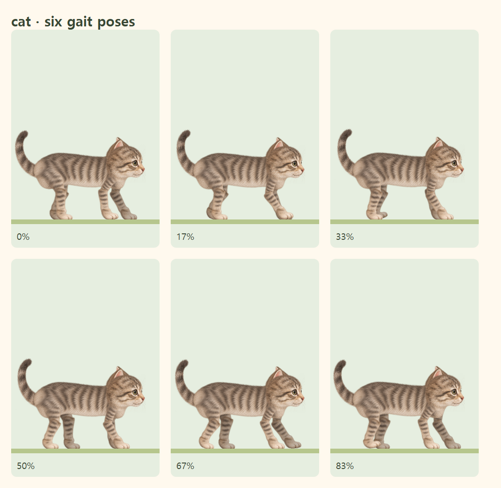

# 강아지·고양이 보행 자세 개선

기존 보행은 지면까지의 거리보다 다리 뼈가 길고 보폭도 커서, 멈춰 있을 때도 무릎을 깊게 접고 걸을 때 팔처럼 크게 뻗었습니다. v8 몸통 원화와 원래 다리 그림을 재사용하며 리그의 비율과 발 궤적을 조정했습니다.

| 항목 | 강아지 | 고양이 |
| --- | --- | --- |
| 한 주기 지면 이동 | 72 → 32 | 약 92 → 30 |
| 발 최대 높이 | 9 → 4 | 7 → 3 |
| 가까운 뒷다리 길이 | 28 + 29 → 22 + 22 | 28 + 28 → 22 + 23 |
| 가까운 앞다리 길이 | 25 + 25 → 20 + 21 | 27 + 28 → 20 + 22 |

수치는 160 × 210 아트 좌표 기준입니다. 몸통·머리·귀·다리 뿌리와 지면의 위치를 유지하고, 뼈 사이의 그림은 원래 종횡비로 맞춥니다. 앞다리는 가슴을 받치고, 뒷다리는 작게 접어 내딛습니다. 먼 쪽 다리는 뿌리가 2만큼 높아 총 길이도 2만큼 더 줍니다.

네 발의 순서, 1.44초/1.9초의 보행 주기, 낮은 몸의 흔들림을 유지합니다. 고양이는 긴 몸통에 맞춰 뒷발을 앞발의 지난 자리에 정확히 찍도록 강제하던 수식을 제거했습니다. 이 작은 캐릭터에서는 그 조건이 과도한 보폭을 만들었습니다. 실제 모션 캡처가 아닌 편안한 네발걸음을 위한 일러스트 리그입니다.

지면 속도와 도착 후 감속 시간도 같은 `travel / cycleMs`를 사용하므로 발만 느려지고 바닥은 빠르게 흐르는 불일치가 생기지 않습니다. 메인 캐릭터·진행바·미리보기가 같은 리그를 사용합니다.

## 실제 브라우저에서 캡처한 여섯 자세

## 검증

- 한 주기 400개 표본에서 지지하는 앞다리의 과도한 접힘, 과도한 보폭·발 높이를 검사합니다.
- 기존 접지·반복 경계·뼈 원화 연결 테스트를 유지합니다.
- 실제 렌더링 12개 자세에서 네 다리의 연결과 관절 좌표를 검사합니다.
- Chrome과 모바일 WebKit에서 발 접지, 일시정지·재개·새로고침, 진행바 동기화·도착·모션 감소를 검사합니다.

변경 파일: `src/lib/walkingAnatomy.ts`, `src/lib/animalMotion.ts`, `tests/animalMotion.test.ts`.
